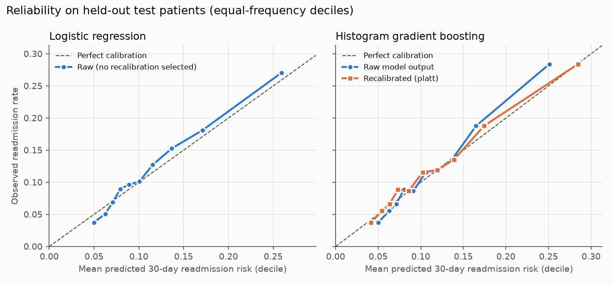
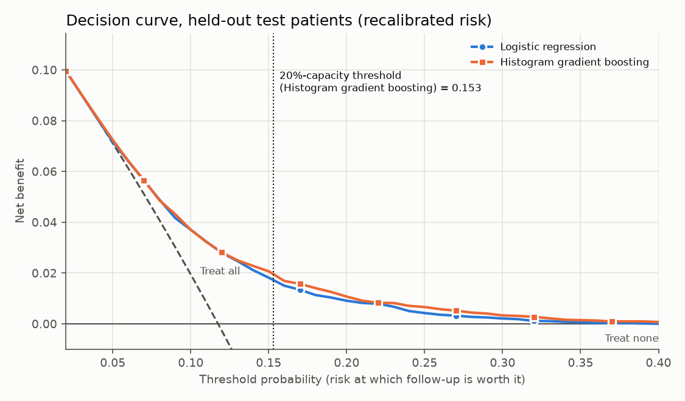
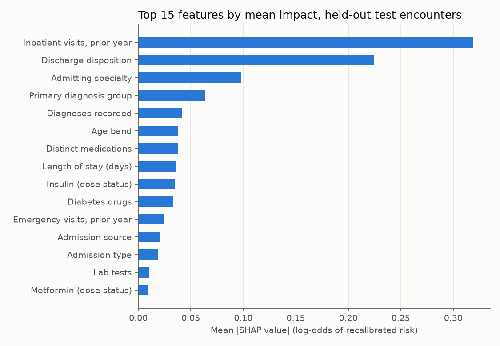
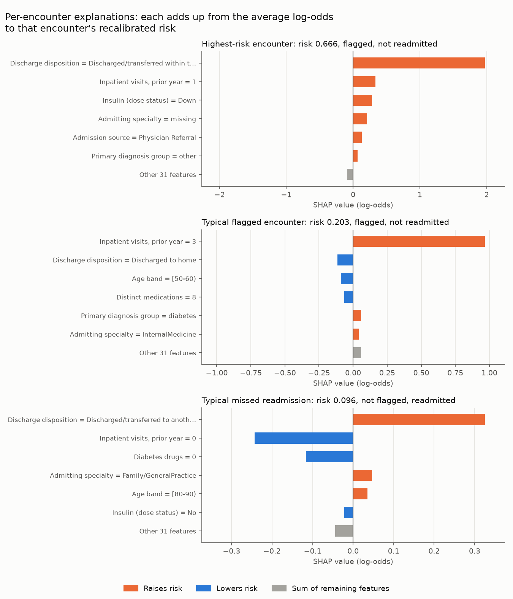
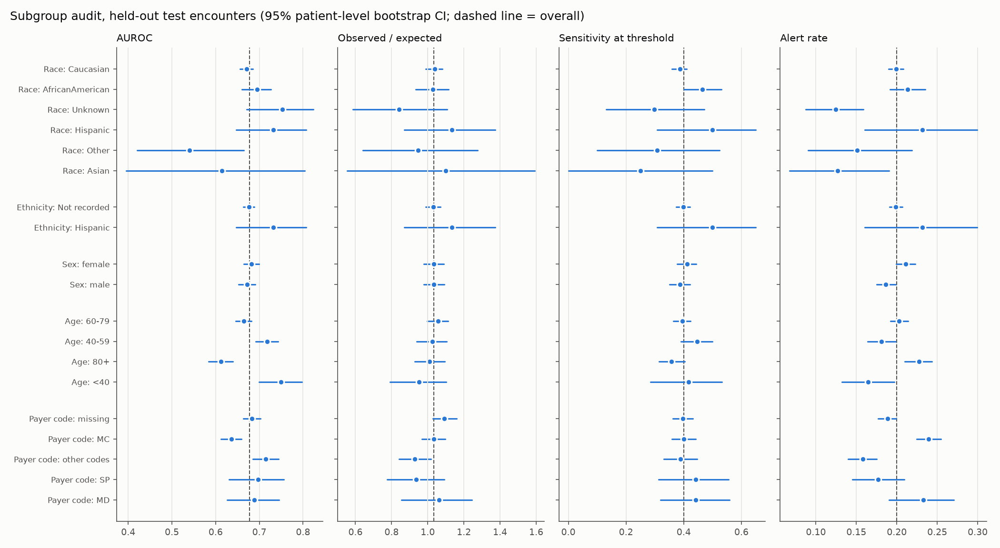

# clinical-ml: FHIR/EHR → OMOP warehouse → 30-day readmission risk

The pipeline has four stages:
1. It loads two public clinical sources into an **OMOP CDM v5.4** warehouse (DuckDB):
   - a 130-hospital US EHR extract;
   - real **HL7 FHIR R4** resources from MIMIC-IV.
2. An **Airflow** DAG orchestrates it, with **data-quality gates**.
3. It defines a **30-day readmission** cohort in SQL that runs unchanged against each CDM.
4. It trains baseline risk models, tracked in **MLflow**.

Later milestones add calibration, conformal prediction, a capacity-based clinical
threshold, SHAP explanations, a fairness audit and a [model card](MODEL_CARD.md) (see
[SCOPE.md](SCOPE.md)). The reasoning behind every
design choice is in [EXPLAIN.md](EXPLAIN.md).

Every number below is produced by code in this repo; none are estimated. The results
block is regenerated from `reports/*.json` by `make report`.

## Status

| Milestone | Contents | State |
|---|---|---|
| M1 | Sources + checksums, OMOP ETLs (Diabetes-130, FHIR), Airflow DAG, DQ gates, cohort, patient-level split, LR + GBM baselines, MLflow | **done** |
| M2 | Calibration, split-conformal sets, capacity-based threshold, decision curve | **done** |
| M2b | XGBoost benchmark vs LR and HistGBM: same split, features and bootstrap, all three trained in one run | **done** (Linux GPU node) |
| M3 | TreeSHAP explanations, Fairlearn subgroup audit with CIs, [model card](MODEL_CARD.md) | **done** |
| M4 | Docker, GitHub Actions CI, Terraform (Azure, validate only), Streamlit monitor | planned |

## Results (M1)

<!-- results:start -->

_Generated by `make report` from `reports/metrics_m1.json`, `reports/dq.json` and `reports/cohorts.json`._

**Test set (held-out patients, scored once).** 13,997 patients / 20,047 encounters, readmission rate 0.118. 95% CIs from 2,000 patient-level bootstrap resamples.

| Model | AUROC | AUPRC | Brier | Grouped 5-fold CV AUROC (train) | MLflow run |
|---|---|---|---|---|---|
| Logistic regression (L2) | 0.673 (0.661–0.686) | 0.222 (0.205–0.242) | 0.0991 (0.0954–0.1028) | 0.656 ± 0.006 | `ff87392a` |
| Histogram gradient boosting | 0.678 (0.665–0.690) | 0.235 (0.216–0.255) | 0.0986 (0.0948–0.1022) | 0.664 ± 0.007 | `4cb824d2` |

Paired AUROC difference (gradient boosting − logistic): 0.0043 (-0.0003–0.0090).
These are the raw M1 probabilities; recalibration, conformal sets and the operating point are in the M2 results below.

**Patient-level split** (no patient in two splits):

| Split | Patients | Encounters | 30-day readmission rate |
|---|---|---|---|
| train | 41,991 | 59,341 | 0.112 |
| calibration | 13,997 | 19,941 | 0.115 |
| test | 13,997 | 20,047 | 0.118 |

**Cohorts** (same SQL over both OMOP CDMs):

| Source | Inpatient visits | Excluded: died / hospice | Excluded: after recorded death | Eligible | Patients | 30-day readmissions |
|---|---|---|---|---|---|---|
| d130 | 101,766 | 2,423 | 14 | 99,329 | 69,985 | 11,305 (11.4%) |
| mimic | 275 | 20 | 0 | 255 | 93 | 53 (20.8%) |

**Data quality.** All error-level checks pass. Source → OMOP reconciliation:

| Check | Source | OMOP |
|---|---|---|
| d130 encounters -> visit_occurrence | 101,766 | 101,766 |
| d130 distinct patients -> person | 71,518 | 71,518 |
| d130 non-missing diag_1..3 -> condition_occurrence | 303,496 | 303,496 |
| d130 LOS within source inclusion (1-14 days) | 101,766 | 101,766 |
| mimic Patient -> person | 100 | 100 |
| mimic hospital+ED Encounter -> visit_occurrence | 497 | 497 |
| mimic Condition -> condition_occurrence | 5,051 | 5,051 |
| mimic Observation -> measurement + observation | 784,149 | 784,149 |
| mimic labs linked to a visit (by time window) | 107,727 | 80,103 |

Standard-concept coverage (rows with a non-zero concept_id):

| CDM | Table | Rows | Rows mapped | Distinct source codes |
|---|---|---|---|---|
| cdm_d130 | condition_occurrence | 303,496 | 0.0% | 915 |
| cdm_d130 | drug_exposure | 120,777 | 0.0% | 21 |
| cdm_d130 | measurement | 25,561 | 0.0% | 3 |
| cdm_d130 | observation | 1,087,765 | 0.0% | 31 |
| cdm_mimic | condition_occurrence | 5,051 | 0.0% | 1,575 |
| cdm_mimic | drug_exposure | 17,552 | 0.0% | 1,644 |
| cdm_mimic | procedure_occurrence | 3,450 | 0.0% | 436 |
| cdm_mimic | measurement | 372,761 | 0.0% | 1,051 |
| cdm_mimic | observation | 411,388 | 0.0% | 778 |

Finding (info): no clinical visits start after death: 14 of 101,766 rows fail.

<!-- results:end -->

## Results (M2): calibration, uncertainty, operating point

<!-- results-m2:start -->

_Generated by `make report` from `reports/metrics_m2.json` (MLflow run `e66aaf12`). 95% CIs from 1,000 patient-level bootstrap resamples of the test split._

**Calibration on test** (recalibration chosen by grouped-CV Brier on the calibration split):

| Model | Recalibration | Calibration slope | Intercept (log-odds) | Observed / expected | ECE | Brier |
|---|---|---|---|---|---|---|
| Logistic regression (L2) | none (raw) | 1.077 (1.002–1.151) | 0.042 (-0.005–0.088) | 1.036 (0.995–1.077) | 0.0093 (0.0070–0.0145) | 0.0991 (0.0954–0.1029) |
| Histogram gradient boosting | none (raw) | 1.178 (1.099–1.252) | 0.042 (-0.005–0.087) | 1.036 (0.996–1.077) | 0.0106 (0.0085–0.0162) | 0.0986 (0.0949–0.1023) |
| Histogram gradient boosting | platt | 0.981 (0.915–1.042) | 0.039 (-0.006–0.084) | 1.033 (0.995–1.073) | 0.0055 (0.0051–0.0120) | 0.0984 (0.0947–0.1021) |



**Operating point: follow up the top 20% of discharges** (threshold fixed on the calibration split, then applied to test):

| Model | Threshold | Flag rate | Sensitivity | Specificity | PPV | NPV |
|---|---|---|---|---|---|---|
| Logistic regression (L2) | 0.152 | 0.198 (0.190–0.206) | 0.381 (0.358–0.404) | 0.826 (0.819–0.833) | 0.226 (0.211–0.240) | 0.909 (0.905–0.914) |
| Histogram gradient boosting | 0.153 | 0.200 (0.191–0.208) | 0.401 (0.378–0.424) | 0.827 (0.819–0.835) | 0.236 (0.221–0.251) | 0.912 (0.908–0.917) |

Test readmission rate (the PPV of flagging at random): 0.118.



| Model | Net benefit at threshold 0.10 | 0.15 | 0.20 | 0.30 | Beats treat-all and treat-none over |
|---|---|---|---|---|---|
| Logistic regression (L2) | 0.0370 (0.0323–0.0420) | 0.0182 (0.0145–0.0219) | 0.0091 (0.0062–0.0119) | 0.0021 (0.0007–0.0036) | 0.04–0.40 (of 0.02–0.40 evaluated) |
| Histogram gradient boosting | 0.0371 (0.0324–0.0420) | 0.0207 (0.0168–0.0247) | 0.0107 (0.0078–0.0138) | 0.0033 (0.0012–0.0054) | 0.02–0.40 (of 0.02–0.40 evaluated) |
| Treat all | 0.0195 (0.0135–0.0256) | -0.0382 (-0.0445–-0.0317) | -0.1031 (-0.1098–-0.0962) | -0.2607 (-0.2683–-0.2528) | |

**Split-conformal prediction sets** (α = 0.1, raw model scores):

| Model | Procedure | Coverage | Coverage, readmitted | Coverage, not readmitted | Sets containing both outcomes | Mean set size |
|---|---|---|---|---|---|---|
| Logistic regression (L2) | marginal | 0.896 (0.892–0.900) | 0.116 (0.099–0.132) | 1.000 | 0.041 (0.037–0.046) | 1.04 |
| Logistic regression (L2) | class-conditional (Mondrian) | 0.904 (0.899–0.910) | 0.907 (0.896–0.919) | 0.904 | 0.652 (0.645–0.659) | 1.65 |
| Logistic regression (L2) | race-conditional (Mondrian) | 0.897 (0.893–0.902) | 0.126 (0.109–0.145) | 1.000 | 0.046 (0.041–0.050) | 1.05 |
| Histogram gradient boosting | marginal | 0.896 (0.892–0.901) | 0.116 (0.098–0.135) | 1.000 | 0.037 (0.032–0.041) | 1.04 |
| Histogram gradient boosting | class-conditional (Mondrian) | 0.901 (0.896–0.906) | 0.898 (0.886–0.910) | 0.901 | 0.644 (0.637–0.652) | 1.64 |
| Histogram gradient boosting | race-conditional (Mondrian) | 0.896 (0.892–0.901) | 0.121 (0.101–0.139) | 0.999 | 0.040 (0.036–0.045) | 1.04 |

Class-conditional coverage by race (Histogram gradient boosting): AfricanAmerican 0.893 (n=3,683), Asian 0.915 (n=118), Caucasian 0.902 (n=15,095), Hispanic 0.874 (n=419), Other 0.894 (n=265), Unknown 0.946 (n=467).

Model carried into M3: **Histogram gradient boosting** (lowest calibration-split grouped-CV Brier after recalibration).

<!-- results-m2:end -->

**How to read these results:**
- **Calibration.**
  - Gradient boosting's raw probabilities are too timid: the calibration slope is above 1,
    so its predictions are bunched toward the average. Platt scaling, fitted on the
    calibration split, brings the slope to about 1.
  - Logistic regression was already calibrated, and the selection rule kept it raw.
  - Both models slightly under-predict on test (observed / expected above 1). The CI
    includes 1.
- **Operating point.** At a fixed follow-up capacity the model roughly doubles the hit
  rate compared with random selection (PPV vs the base rate). It still misses most
  readmissions (sensitivity). That is the realistic ceiling for structured-data
  readmission models, not a bug.
- **Decision curve.** Acting on the model gives more net benefit than following up everyone
  or no one across the evaluated thresholds:
  - gradient boosting from the lowest threshold evaluated;
  - logistic regression from slightly higher (see the table).
  - The two models are almost indistinguishable below about 0.12, and gradient boosting is
    slightly ahead above it.
- **Conformal sets.**
  - *Marginal* split conformal meets its 90% coverage target almost entirely by covering
    patients who were not readmitted. Coverage for readmitted patients is very low. This
    is the known failure mode of marginal guarantees at low prevalence.
  - *Class-conditional* (Mondrian) conformal restores about 90% coverage in both classes.
    The cost is that most encounters get the uninformative "could be either" set.
  - That is the honest uncertainty statement for a model with this level of discrimination.
  - Race-conditional sets are reported as input to the fairness audit in M3.

## Results (M2b): XGBoost benchmark

<!-- results-benchmark:start -->

_Generated by `make report` from `reports/benchmark.json`. All three models trained in one run on Linux-6.8.0-147-generic-x86_64-with-glibc2.39 (128 CPU threads, NVIDIA RTX PRO 6000 Blackwell Server Edition); XGBoost 3.4.1 trained on `cuda:0`, scikit-learn 1.9.1. 95% CIs from 2,000 patient-level bootstrap resamples of the test split (13,997 patients)._

| Model | AUROC | AUPRC | Brier | Grouped 5-fold CV AUROC (train) | Selected hyperparameters | Selection + fit time | MLflow run |
|---|---|---|---|---|---|---|---|
| Logistic regression (L2) | 0.673 (0.661–0.686) | 0.222 (0.205–0.242) | 0.0991 (0.0954–0.1028) | 0.656 ± 0.006 | C=0.1 | 10 s | `67bb6f42` |
| Histogram gradient boosting | 0.678 (0.665–0.690) | 0.235 (0.216–0.255) | 0.0986 (0.0948–0.1022) | 0.664 ± 0.007 | learning_rate=0.02, max_leaf_nodes=15, max_iter=200 | 131 s | `63e92e50` |
| XGBoost | 0.677 (0.664–0.689) | 0.235 (0.217–0.256) | 0.0985 (0.0947–0.1022) | 0.662 ± 0.006 | learning_rate=0.1, max_depth=3, n_estimators=100 | 47 s | `ae70b2c6` |

**Selection surface** (grouped CV on train only; a choice at a grid edge matters only if the surface is still rising there):

| Model | Grid points | Best CV AUROC | 5th best | Fold SD (best) | Selected value at a grid edge |
|---|---|---|---|---|---|
| Logistic regression (L2) | 3 | 0.6560 | — | 0.0058 | none |
| Histogram gradient boosting | 27 | 0.6637 | 0.6636 | 0.0067 | learning_rate=0.02 (min) |
| XGBoost | 27 | 0.6624 | 0.6619 | 0.0064 | learning_rate=0.1 (max), max_depth=3 (min), n_estimators=100 (min) |

Paired AUROC differences, each model minus Logistic regression (L2) (same bootstrap resamples):

- Histogram gradient boosting: 0.0043 (-0.0003–0.0090)
- XGBoost: 0.0036 (-0.0009–0.0082)

<!-- results-benchmark:end -->

**How to read these results:**
- **The learner is not the bottleneck.**
  - Both boosted models beat logistic regression by a few thousandths of AUROC, and both
    paired CIs include zero.
  - XGBoost and HistGBM select quite different hyperparameters, yet land on almost the
    same AUROC, AUPRC and Brier score.
  - With these structured, coded features the ceiling is set by the data, not the
    algorithm. Using HistGBM locally, to avoid `libomp`, costs nothing measurable.
- **Cross-platform reproduction.** The node rebuilt everything from the public sources:
  - raw-data checksums and the cohort and DQ reports came out byte-identical to the macOS
    (ARM) run;
  - the logistic regression and HistGBM rows above match the M1 table exactly, on a
    different OS and CPU architecture.
- **XGBoost's grid edge.**
  - Its CV choice sits at a corner of the grid on all three hyperparameters.
  - The selection surface is flat there: the fifth-best point is within a small fraction
    of the fold-to-fold SD of the best.
  - The grid was not extended, because that would mean another adaptive read of the test
    split for a gain the CV surface does not suggest.
- **Timing is not a speed comparison.**
  - The times cover the full grid search plus the final fit.
  - XGBoost ran on the GPU, and the other two on CPU threads.
  - The dataset is small enough that the GPU makes little practical difference. The
    benchmark is about the comparison, not speed.
- **Determinism.** The benchmark ran twice with identical modelling code; the second run
  only added the CV grid to `benchmark.json`. Test metrics, CIs and selected
  hyperparameters were identical, and the table is the second run.

## Results (M3): explanations and subgroup audit

<!-- results-m3:start -->

_Generated by `make report` from `reports/metrics_m3.json` (MLflow run `d92df482`). Test split: 20,047 encounters, 13,997 patients. 95% CIs from 1,000 patient-level bootstrap resamples._

**Explanations** (Histogram gradient boosting, log-odds of recalibrated risk). Exactness check (expected value + SHAP values vs the model's output, largest error over test):

| Method | Largest additivity error (log-odds) |
|---|---|
| TreeSHAP in this repo (`eval/treeshap.py`) | 9.3e-15 |
| `shap` 0.54.1 TreeExplainer | 2.41 |



| Rank | Feature | Mean \|SHAP\| |
|---|---|---|
| 1 | Inpatient visits, prior year | 0.319 |
| 2 | Discharge disposition | 0.224 |
| 3 | Admitting specialty | 0.098 |
| 4 | Primary diagnosis group | 0.063 |
| 5 | Diagnoses recorded | 0.042 |
| 6 | Age band | 0.038 |
| 7 | Distinct medications | 0.038 |
| 8 | Length of stay (days) | 0.036 |
| 9 | Insulin (dose status) | 0.035 |
| 10 | Diabetes drugs | 0.033 |



- **Highest-risk encounter** (risk 0.666, flagged, not readmitted): Discharge disposition = Discharged/transferred within this institution to… (+1.97); Inpatient visits, prior year = 1 (+0.34); Insulin (dose status) = Down (+0.28).
- **Typical flagged encounter** (risk 0.203, flagged, not readmitted): Inpatient visits, prior year = 3 (+0.97); Discharge disposition = Discharged to home (-0.11); Age band = [50-60) (-0.09).
- **Typical missed readmission** (risk 0.096, not flagged, readmitted): Discharge disposition = Discharged/transferred to another short term hospi… (+0.32); Inpatient visits, prior year = 0 (-0.24); Diabetes drugs = 0 (-0.12).

**Subgroup audit** at the M2 threshold (0.153, test alert rate 0.200). Groups with fewer than 100 test encounters or 10 readmissions are not scored.



| Attribute | Group | Encounters | Readmissions | AUROC | Observed / expected | Sensitivity | FPR | PPV | Alert rate |
|---|---|---|---|---|---|---|---|---|---|
| All | all | 20,047 | | 0.678 | 1.033 | 0.401 | 0.173 | 0.236 | 0.200 |
| Race | Caucasian (ref) | 15,095 | 1,792 | 0.671 (0.656–0.685) | 1.038 (0.988–1.081) | 0.387 (0.360–0.410) | 0.174 (0.166–0.183) | 0.231 (0.214–0.246) | 0.199 (0.190–0.208) |
| Race | AfricanAmerican | 3,683 | 435 | 0.695 (0.660–0.727) | 1.027 (0.932–1.116) | 0.464 (0.401–0.530) | 0.180 (0.163–0.198) | 0.257 (0.219–0.294) | 0.213 (0.192–0.235) |
| Race | Unknown | 467 | 37 | 0.753 (0.671–0.824) | 0.841 (0.585–1.108) | 0.297 (0.132–0.471) | 0.109 (0.074–0.141) | 0.190 (0.080–0.317) | 0.124 (0.087–0.159) |
| Race | Hispanic | 419 | 54 | 0.732 (0.647–0.807) | 1.134 (0.870–1.373) | 0.500 (0.308–0.650) | 0.192 (0.128–0.252) | 0.278 (0.170–0.371) | 0.232 (0.161–0.299) |
| Race | Other | 265 | 26 | 0.541 (0.420–0.664) | 0.945 (0.641–1.276) | 0.308 (0.100–0.524) | 0.134 (0.078–0.196) | 0.200 (0.074–0.324) | 0.151 (0.091–0.219) |
| Race | Asian | 118 | 12 | 0.614 (0.395–0.804) | 1.100 (0.554–1.592) | 0.250 (0.000–0.500) | 0.113 (0.053–0.177) | 0.200 (0.000–0.400) | 0.127 (0.067–0.190) |
| Ethnicity | Not recorded (ref) | 19,628 | 2,302 | 0.676 (0.663–0.688) | 1.031 (0.989–1.071) | 0.398 (0.374–0.422) | 0.172 (0.165–0.180) | 0.235 (0.220–0.250) | 0.199 (0.191–0.207) |
| Ethnicity | Hispanic | 419 | 54 | 0.732 (0.647–0.807) | 1.134 (0.870–1.373) | 0.500 (0.308–0.650) | 0.192 (0.128–0.252) | 0.278 (0.170–0.371) | 0.232 (0.161–0.299) |
| Sex | female (ref) | 10,761 | 1,292 | 0.682 (0.665–0.699) | 1.033 (0.979–1.088) | 0.412 (0.378–0.444) | 0.183 (0.172–0.195) | 0.234 (0.214–0.255) | 0.211 (0.199–0.223) |
| Sex | male | 9,285 | 1,064 | 0.672 (0.652–0.691) | 1.034 (0.978–1.091) | 0.387 (0.351–0.421) | 0.161 (0.150–0.171) | 0.238 (0.215–0.258) | 0.187 (0.175–0.198) |
| Age | 60-79 (ref) | 9,521 | 1,162 | 0.664 (0.646–0.681) | 1.057 (0.997–1.113) | 0.395 (0.364–0.424) | 0.176 (0.166–0.186) | 0.238 (0.217–0.257) | 0.203 (0.192–0.214) |
| Age | 40-59 | 5,375 | 576 | 0.718 (0.692–0.743) | 1.026 (0.938–1.105) | 0.446 (0.390–0.500) | 0.149 (0.135–0.163) | 0.264 (0.226–0.300) | 0.181 (0.164–0.199) |
| Age | 80+ | 3,930 | 503 | 0.612 (0.583–0.640) | 1.009 (0.928–1.093) | 0.358 (0.315–0.403) | 0.208 (0.191–0.225) | 0.201 (0.173–0.228) | 0.227 (0.210–0.243) |
| Age | <40 | 1,221 | 115 | 0.750 (0.699–0.797) | 0.952 (0.790–1.101) | 0.417 (0.285–0.533) | 0.138 (0.112–0.165) | 0.239 (0.163–0.303) | 0.165 (0.132–0.197) |
| Payer code | missing (ref) | 7,947 | 951 | 0.683 (0.663–0.702) | 1.091 (1.028–1.160) | 0.397 (0.362–0.431) | 0.160 (0.149–0.170) | 0.252 (0.228–0.274) | 0.188 (0.177–0.199) |
| Payer code | MC | 6,431 | 837 | 0.636 (0.613–0.659) | 1.034 (0.969–1.097) | 0.400 (0.360–0.442) | 0.215 (0.202–0.230) | 0.218 (0.192–0.241) | 0.239 (0.224–0.255) |
| Payer code | other codes | 3,987 | 380 | 0.715 (0.685–0.744) | 0.928 (0.841–1.018) | 0.389 (0.331–0.447) | 0.133 (0.119–0.147) | 0.235 (0.198–0.272) | 0.158 (0.140–0.175) |
| Payer code | SP | 991 | 102 | 0.697 (0.631–0.756) | 0.935 (0.775–1.090) | 0.441 (0.313–0.556) | 0.146 (0.117–0.173) | 0.257 (0.181–0.330) | 0.177 (0.145–0.209) |
| Payer code | MD | 691 | 86 | 0.688 (0.626–0.745) | 1.061 (0.855–1.245) | 0.442 (0.320–0.558) | 0.203 (0.166–0.237) | 0.236 (0.164–0.304) | 0.233 (0.191–0.270) |

Not scored (too small): Sex: unknown (1 encounter).

**Differences from the reference group whose 95% CI excludes zero** (signed: group minus reference; one row per difference):

| Attribute | Group vs reference | Metric | Difference |
|---|---|---|---|
| Race | AfricanAmerican vs Caucasian | Sensitivity | +0.078 (+0.012 to +0.148) |
| Race | Unknown vs Caucasian | AUROC | +0.081 (+0.001 to +0.156) |
| Race | Unknown vs Caucasian | FPR | -0.064 (-0.102 to -0.033) |
| Race | Unknown vs Caucasian | Alert rate | -0.075 (-0.114 to -0.039) |
| Race | Other vs Caucasian | AUROC | -0.131 (-0.250 to -0.011) |
| Race | Asian vs Caucasian | Alert rate | -0.072 (-0.134 to -0.007) |
| Sex | male vs female | FPR | -0.023 (-0.038 to -0.007) |
| Sex | male vs female | Alert rate | -0.024 (-0.041 to -0.007) |
| Age | 40-59 vs 60-79 | AUROC | +0.054 (+0.021 to +0.084) |
| Age | 40-59 vs 60-79 | FPR | -0.027 (-0.044 to -0.012) |
| Age | 40-59 vs 60-79 | Alert rate | -0.022 (-0.042 to -0.003) |
| Age | 80+ vs 60-79 | AUROC | -0.052 (-0.084 to -0.019) |
| Age | 80+ vs 60-79 | FPR | +0.032 (+0.013 to +0.051) |
| Age | 80+ vs 60-79 | Alert rate | +0.025 (+0.003 to +0.044) |
| Age | <40 vs 60-79 | AUROC | +0.085 (+0.035 to +0.137) |
| Age | <40 vs 60-79 | FPR | -0.038 (-0.066 to -0.010) |
| Age | <40 vs 60-79 | Alert rate | -0.038 (-0.074 to -0.004) |
| Payer code | MC vs missing | AUROC | -0.048 (-0.078 to -0.017) |
| Payer code | MC vs missing | FPR | +0.055 (+0.038 to +0.073) |
| Payer code | MC vs missing | PPV | -0.035 (-0.071 to -0.002) |
| Payer code | MC vs missing | Alert rate | +0.051 (+0.032 to +0.071) |
| Payer code | other codes vs missing | Observed / expected | -0.163 (-0.272 to -0.054) |
| Payer code | other codes vs missing | FPR | -0.027 (-0.045 to -0.009) |
| Payer code | other codes vs missing | Alert rate | -0.031 (-0.052 to -0.010) |
| Payer code | MD vs missing | FPR | +0.043 (+0.006 to +0.079) |
| Payer code | MD vs missing | Alert rate | +0.044 (+0.002 to +0.085) |

84 group-vs-reference differences were estimated, so about 4 would exclude zero by chance alone at the 5% level.

**Largest gap** (highest minus lowest scored group; Fairlearn between-groups difference; point estimate):

| Attribute | AUROC | Observed / expected | Sensitivity | FPR | PPV | Alert rate | Equalized odds |
|---|---|---|---|---|---|---|---|
| Race | 0.212 | 0.293 | 0.250 | 0.082 | 0.089 | 0.107 | 0.250 |
| Ethnicity | 0.056 | 0.103 | 0.102 | 0.019 | 0.043 | 0.033 | 0.102 |
| Sex | 0.010 | 0.001 | 0.025 | 0.023 | 0.003 | 0.024 | 0.025 |
| Age | 0.137 | 0.105 | 0.088 | 0.070 | 0.063 | 0.063 | 0.088 |
| Payer code | 0.079 | 0.163 | 0.052 | 0.082 | 0.039 | 0.081 | 0.082 |

<!-- results-m3:end -->

**How to read these results:**
- **Why this repo computes SHAP itself.**
  - `shap`'s TreeExplainer reads HistGradientBoosting trees as if every split were
    numeric. It ignores the model's native categorical splits, so its values do not add
    up to the model's output (the exactness table above). No error or warning is raised.
  - `eval/treeshap.py` ports the same TreeSHAP algorithm and follows categorical splits
    the way scikit-learn does.
  - The tests check it against `shap` on numeric-only models, where `shap` is correct,
    and every run asserts exact additivity on the real model.
- **What drives risk.**
  - Prior-year inpatient use and discharge disposition dominate. Prior utilisation is
    the best-known readmission predictor, so that part is expected.
  - Discharge disposition is more delicate. Transfers within the same institution or to
    another short-term hospital push risk up strongly. These codes describe the care
    pathway, so they may encode how care is organised rather than what the patient needs.
    The [model card](MODEL_CARD.md) flags this for clinical review.
  - The missed-readmission example shows the limit of structured data: a patient with no
    prior inpatient use looks low-risk to the model.
- **Calibration within groups** mostly holds: most groups' observed/expected CIs include 1.
  The model under-predicts for encounters with no payer recorded, and over-predicts for
  the pooled "other codes" payers relative to them.
- **Equal opportunity** (sensitivity at the shared threshold).
  - No scored race group has lower sensitivity than the reference group with a CI that
    excludes zero. African American patients have *higher* sensitivity.
  - The smaller race groups (Asian, Other, Unknown) have point estimates below the
    reference, but their CIs are too wide to conclude anything. The audit is
    underpowered for them; that is a finding, not a clean bill of health.
- **Age is the clearest pattern.**
  - Discrimination falls steadily with age.
  - Patients 80 and over have lower AUROC, and more false positives and alerts, than the
    60–79 reference.
  - Payer code MC shows the same pattern against the reference payer group: lower
    AUROC, and more false positives and alerts.
  - **Sex:** female patients are flagged slightly more often, with a slightly higher
    false-positive rate. Sensitivity and calibration do not differ.
- **Alert-rate differences are not unfair on their own.** Groups whose real risk differs
  should be flagged at different rates. The criteria that matter for this use are
  calibration within groups and equal sensitivity at the shared threshold.
- **Multiple comparisons.** Some differences will exclude zero by chance (see the count
  under the table). The age and payer patterns hold across several metrics at once,
  which chance findings would not.
- **Not assessed:** intersectional groups, and label bias. Readmissions to hospitals
  outside the dataset are never observed, and that may differ by group.

## Data

| Source | Use | License |
|---|---|---|
| [Diabetes 130-US Hospitals 1999–2008](https://archive.ics.uci.edu/dataset/296) (Strack et al., 2014, doi:10.1155/2014/781670) | 101,766 de-identified inpatient encounters; readmission model | CC BY 4.0 |
| [MIMIC-IV Clinical Database Demo on FHIR v2.1.0](https://physionet.org/content/mimic-iv-fhir-demo/2.1.0/) (Bennett et al., 2025; Johnson et al.) | FHIR R4 ingestion; cohort logic on real dated visits | ODbL v1.0 |

- **Checksums.** Downloads are checked against PhysioNet's `SHA256SUMS.txt`, and against a
  pinned SHA-256 for the UCI zip.
- **Privacy.** Both sources are public and de-identified. No PHI is used, stored or sent
  anywhere. No credentialed MIMIC data is used. Copies of MIMIC re-uploaded to Kaggle or
  Hugging Face are deliberately avoided, because they breach the PhysioNet data use agreement.

## Warehouse design

- **One OMOP CDM schema per source** (`cdm_d130`, `cdm_mimic`), a shared `vocab` schema, and
  `results` for cohorts, labels, features and predictions. This is the OHDSI network pattern:
  the cohort SQL is written once and runs against each CDM.
- **DDL.** It is the official OHDSI DuckDB DDL for CDM v5.4, vendored unmodified, so primary
  keys and NOT NULL constraints are enforced at load.
- **Source values are always kept.** Standard concept IDs need the OHDSI Athena vocabulary
  files, which require a free Athena login. To add them, put the files in `data/vocab/`
  (`CONCEPT.csv`, `CONCEPT_RELATIONSHIP.csv`, `VOCABULARY.csv`) and rerun `make omop`.
  Until then, clinical `concept_id`s are 0, and the coverage table above reports that.
  Gender, race, ethnicity, visit and type concepts use well-known standard IDs.

**Mapping decisions worth knowing:**
- **Race vs ethnicity.** Diabetes-130 puts "Hispanic" in race. OMOP keeps race and ethnicity
  separate, so it maps to ethnicity = Hispanic with race unknown.
- **ICD-9 normalisation.**
  - Diabetes-130 strips leading zeros (`8` → `008`, `41.9` → `041.9`).
  - MIMIC strips dots (`4280` → `428.0`, `V462` → `V46.2`).
  - Both are normalised to Athena's dotted form, so vocabulary joins work.
- **Date shift (Diabetes-130).** The source has no dates. Each patient's encounters are
  ordered by `encounter_id` and placed 365 days apart from 2000-01-01, and each visit ends
  after `time_in_hospital` days. The placeholder dates are never used as features. The DQ
  report shows 14 encounters that fall after the patient's "Expired" encounter, so
  `encounter_id` order is not strictly chronological. Those 14 are excluded from the cohort.
- **Readmission outcome.**
  - Diabetes-130 supplies it as a label, which is stored in `results`, not as a clinical fact.
  - For MIMIC it is derived from consecutive admissions' real (shifted) dates.
- **FHIR specifics.**
  - Blood-pressure panels are split into their component measurements.
  - Labs, which carry no encounter reference, are linked to the admission whose period contains them.
  - ICU stays become `visit_detail` under their admission.
  - Numeric chartevents go to `measurement`; text chartevents go to `observation`.
  - OMOP keys reuse MIMIC's own `subject_id` / `hadm_id` / `stay_id`.

## Modelling protocol (M1)

- **Cohort:** inpatient visits, excluding in-hospital death, hospice discharge, and records
  dated after a recorded death.
- **Outcome:** readmission within 30 days.
- **Features:** 37 features from OMOP tables. They cover age band and sex, admission
  type/source, discharge disposition, specialty and length of stay. They also include
  prior-year utilisation, encounter counts, primary and secondary diagnosis groups, the
  diabetes medication regimen, and HbA1c and glucose categories. **Race, ethnicity and
  payer are not features**; they are reserved for the fairness audit.
- **Split:** by patient, 60/20/20 train/calibration/test, with a fixed seed. Hyperparameters
  are chosen by grouped 5-fold CV on train only. The calibration split is reserved for M2.
  The test split is scored once.
- **Models:**
  - L2 logistic regression (one-hot categoricals, log-scaled counts);
  - scikit-learn `HistGradientBoostingClassifier`, with native categoricals.
  - LightGBM and XGBoost were tried. Their macOS wheels need Homebrew's OpenMP, which
    would break the project's isolated environment. XGBoost is benchmarked on Linux
    instead (M2b).
- **Uncertainty:** 95% CIs come from a patient-level (cluster) bootstrap of the test set.
  Patients contribute several encounters, so resampling rows would overstate precision.

**Protocol notes (disclosed for transparency):**
- **The test split was scored twice in M1.**
  - The first run used a smaller gradient-boosting grid. Its cross-validated choice sat at
    the grid's smallest corner (MLflow run `c275f565`, test AUROC 0.680).
  - The grid was extended because of that *CV* edge result, not because of the test score.
    Selection is still by grouped CV on train only.
  - The table above is from the final run.
  - From M2 on, the test split is used only for final reporting.
- **The chosen learning rate (0.02) is the grid minimum**, but the total shrinkage
  (learning rate × iterations = 4) is interior: 0.02 × 400 was available and not selected.
  So the optimum is not being cut off by the grid.
- **Test AUROC is above the train-CV AUROC.** For both models it falls within the test-set
  bootstrap CI. The final models are also fit on all of train, whereas the CV folds each
  use only 80% of it.
- **No clear winner.** The gradient-boosting − logistic difference in AUROC is small and
  its CI touches zero. The interpretable logistic model is a credible deployment candidate.

## Modelling protocol (M2)

Fixed before test was scored for M2. Everything is *fitted or chosen* on the
calibration split, and the test split only *reports*.

- **Recalibration:** none, Platt or isotonic, chosen by grouped (patient) 5-fold CV Brier
  on the calibration split.
- **Operating threshold:** the 80th percentile of recalibrated risk on the calibration
  split, i.e. a team that can follow up 20% of discharges. It is frozen and then applied
  to test.
- **Conformal:** LAC score `1 − p̂(y)` on the raw model output, which the calibration split
  never trained, at α = 0.1. Three variants: marginal, class-conditional, and
  race-conditional (Mondrian). Patients were split at random, but a patient can contribute
  several encounters, so encounter-level coverage is approximately rather than exactly
  guaranteed. That is why measured coverage is reported with CIs.
- **Decision curve:** net benefit = TP/n − FP/n · t/(1−t), for thresholds 0.02–0.40.
- **Model carried into M3:** the one with the lowest calibration-split CV Brier after
  recalibration.
- **XGBoost benchmark (`make benchmark`, Linux only):**
  - it reuses the persisted split and checks it against the seed;
  - the features and selection procedure are identical to the other models, with a
    27-point grid;
  - logistic regression, HistGBM and XGBoost are trained in one process, and paired
    bootstrap differences come from 2,000 resamples;
  - it is another read of the test split. Nothing was selected from it. Logistic
    regression and HistGBM are refit exactly as in M1 and give the same test numbers;
  - XGBoost's input stays on the CPU, so prediction falls back from GPU to CPU. XGBoost
    warns about this; it affects speed only, not results.

## Modelling protocol (M3)

Fixed before the audit was run on test.

- **Model:** the primary model from M2. The exact M1 artifact is loaded from MLflow and
  must reproduce the stored predictions bit for bit.
- **Recalibration:** refitted on the calibration split, and it must reproduce M2's
  threshold exactly.
- **Explanations:** path-dependent TreeSHAP (Lundberg et al., 2020) on the log-odds of
  recalibrated risk.
  - Platt scaling is affine in log-odds, so this only rescales the raw-model SHAP
    values, and each explanation adds up to the risk a user sees.
  - Global importance is the mean |SHAP| over test encounters.
  - Example encounters are chosen by rule: the highest risk, the median flagged
    encounter, and the median missed readmission.
- **Audit:** on the test split, at the M2 capacity threshold.
  - Attributes: race, ethnicity, sex, four age bands, and payer code. The payer groups
    are MC, MD and SP, all other codes pooled, and missing; the codes are not
    documented by the source.
  - Groups below a minimum size (in the results header) are not scored.
  - Each group is compared with its attribute's largest group, using paired
    patient-level bootstrap CIs.
  - The largest gap is a point estimate. Its percentile CI would be misleading, because
    a max-minus-min statistic can never fall below zero.
- **Implementation checks:**
  - Point estimates use Fairlearn's `MetricFrame`, `difference()` and
    `equalized_odds_difference()`.
  - The bootstrap uses a vectorised equivalent, and every run asserts that it matches
    Fairlearn exactly.
- **Source values:** OMOP source-value columns are 50 characters wide, so longer source
  text (some discharge dispositions) appears cut, marked with "…".

## Reproduce

Everything installs and writes inside this folder: a project-local Python via `uv`, `.venv`,
a separate `.venv-airflow`, `AIRFLOW_HOME=.airflow`, `data/`, `mlflow.db` and `mlruns/`.
Delete the folder and nothing is left behind. The only requirement is `uv`.

```bash
make setup           # project-local Python 3.12 + .venv
```

```bash
make setup-airflow   # Airflow 3.3.2 in its own env (its pins clash with MLflow's)
```

```bash
make all             # download → OMOP → DQ → cohort → train → evaluate (M2) → audit (M3) → README results
```

```bash
make dag-test        # the same pipeline, orchestrated by Airflow
```

```bash
make test lint       # hermetic tests on hand-written fixtures; ruff
```

The XGBoost benchmark runs on Linux only, after `make all` (DEVICE=cpu also works):

```bash
make setup-benchmark benchmark report DEVICE=cuda
```

## Layout

```
src/clinical_ml/
  sources.py            download + checksum verification
  omop/ddl/             official OHDSI CDM v5.4 DuckDB DDL (vendored)
  omop/schema.py        schema creation; omop/vocab.py concept IDs, code normalisation, Maps-to lookup
  etl/diabetes130.py    flat EHR extract -> cdm_d130
  etl/fhir_mimic.py     FHIR R4 NDJSON -> cdm_mimic
  dq/checks.py          conformance / plausibility / completeness + source reconciliation
  cohort/               readmission cohort SQL (both CDMs) and Diabetes-130 features
  models/train.py       split, grouped CV, baselines, MLflow
  eval/metrics.py       patient-level bootstrap CIs
  eval/calibration.py   recalibration + slope/intercept/ECE; eval/conformal.py split conformal
  eval/decision.py      capacity threshold, net benefit; eval/m2.py the M2 run + figures
  eval/treeshap.py      exact TreeSHAP for HistGradientBoosting incl. categorical splits
  eval/fairness.py      subgroup audit (Fairlearn + patient-level bootstrap); eval/m3.py the M3 run
  models/benchmark.py   LR vs HistGBM vs XGBoost in one run (Linux / GPU node)
  report.py             README results blocks and MODEL_CARD.md table from reports/*.json
dags/omop_readmission.py  Airflow DAG (orchestration only; tasks call the CLI)
tests/                  hermetic fixtures + unit/integration tests
```

## Limitations

- **Structured data only.** No public dataset links notes, vitals and readmission for the
  same patients, so the readmission model has no text or time-series inputs.
- **Diabetes-130 is old and narrow.** It covers 1999–2008, ICD-9 coding, and diabetic
  inpatient encounters only. It has no dates, so there is no temporal validation.
- **The MIMIC FHIR demo has 100 patients.** It validates the FHIR ETL and the cohort logic,
  and is not used for modelling.
- **This is a research portfolio project, not a validated clinical tool.**
